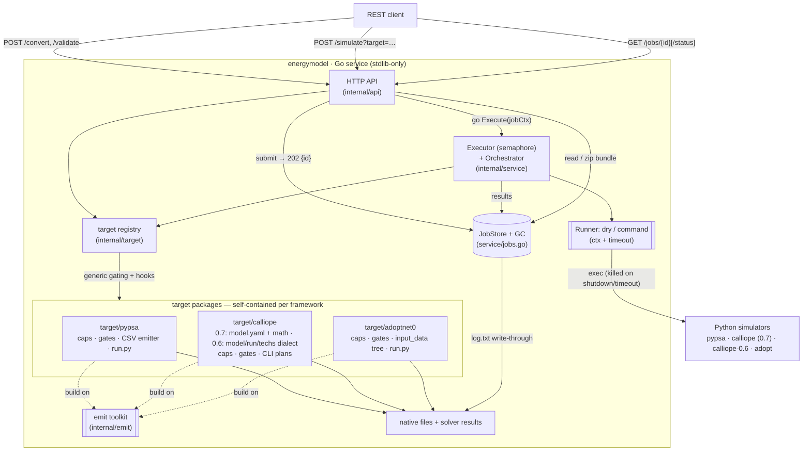
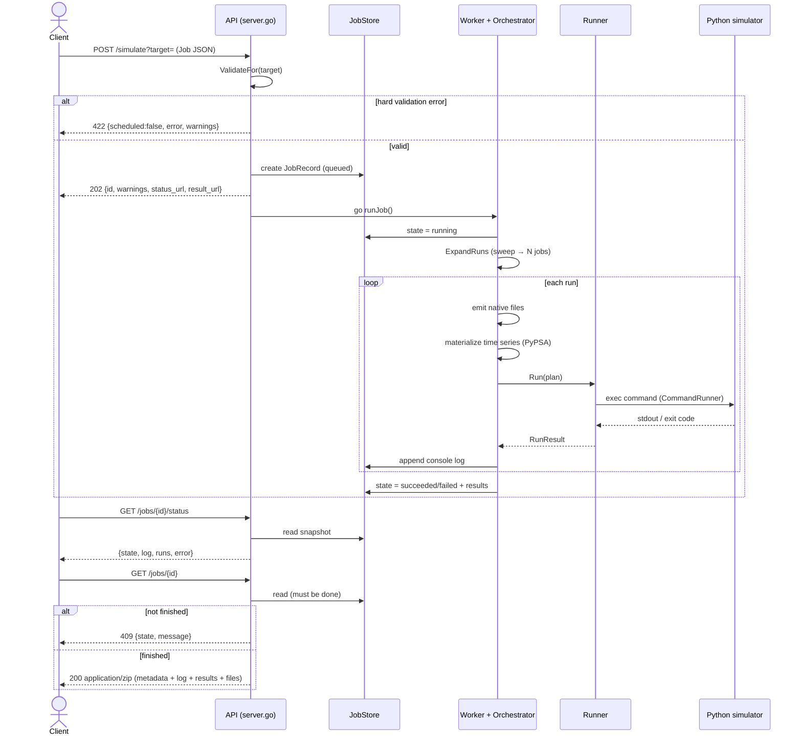
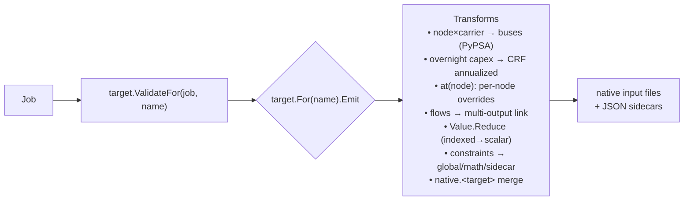
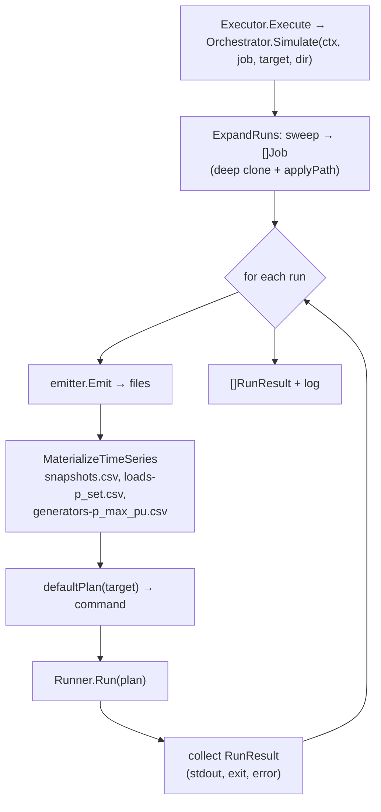

# Architecture


## System architecture



**Colour of responsibility.** Everything inside `Service` is deterministic Go.
Each **target package** is a self-contained plugin (capability profile,
validation gates, emitter, run plan) registered with the **target registry**,
which owns the generic capability-driven validation. The **emit toolkit** is
the shared file-writing vocabulary the targets build on. The **Executor**
bounds solver concurrency and threads the server-lifetime context into every
solver process; the **JobStore** is the only shared mutable state (logs
write-through to disk, finished jobs are garbage-collected). The **Python
simulators** are the only external processes.


## Component catalog

| Package / file | Component | Responsibility |
|---|---|---|
| `internal/model` | canonical structs, `Model.Validate`, `Value`, constraint IR, `Performance`, electrical fields (`NodeElectrical`, `TransmissionElectrical`, `Technology.Dispatch`, `PowerFlowOptions`), `Native`, `Feature` | The framework-neutral vocabulary: JSON schema, structural + referential validation, shared feature names. Knows no target specifics. |
| `internal/emit` | `WriteCSV`, `WriteJSON`, `Ftoa`, `ValScalar`/`ScalarOr`/`OptFloat`, `AnnualizedCapex`, series helpers, native merge | Shared emission toolkit the target packages build on (CRF math, deterministic writers, native passthrough merging). |
| `internal/target` | `Target` interface (`Name`/`Version`/…), `Variant`, `Register`/`RegisterAlias`/`For`/`Resolve`/`Names`/`Defaults`/`Versions`, `ValidateFor`, `CapabilityMatrix`, `RunPlan` | The registry: resolves targets (and version aliases), separates default targets from version variants (`all` = defaults), aggregates capability profiles and framework versions, and orchestrates validation (structural → generic capability gates → per-target hooks → native warnings). |
| `internal/scripts` | `PyPSARun`, `AdOptNET0Run` | The Python driver scripts (`pypsa_run.py`, `adoptnet0_run.py`), embedded and exported for the target packages (go:embed cannot cross package directories). |
| `internal/target/pypsa` | `PyPSA`, `Emitter`, `MaterializeTimeSeries`, `ScenarioSets`, `powerflow.go` | Everything PyPSA: capability profile, mode preconditions, CSV-folder emitter + time-varying materialization, scoped-constraint projection, stochastic translation, the power-flow network (AC buses, lines, transformers, fixed `p_set`, slack control) and its gates, generated run.py driver (body from `internal/scripts/pypsa_run.py`; its `power_flow` branch runs `lpf()`/`pf()` and writes the result tables). |
| `internal/target/calliope` | `Calliope` (0.7), `Calliope06` (0.6), `Emitter`, `Emitter06`, math builders, YAML writer | Both Calliope releases. 0.7 (`calliope`, alias `calliope-0.7`): capability profile, MILP/piecewise/series gates, model.yaml + data tables + extra math (ratio pinning, piecewise, MILP), `calliope` CLI plan. 0.6 (`calliope-0.6`, a version variant): its own profile (k-means typical days and a native emissions objective gained; indexed params / piecewise / custom math absent) and gates, the model/run/techs/locations/links emitter with `file=` timeseries CSVs, conversion_plus carrier tiers and group_constraints, `calliope-0.6` CLI plan. Shared dependency-free YAML writer (fuzz-tested) and native merge (flat for 0.7, deep for 0.6's nested mappings). |
| `internal/target/adoptnet0` | `AdOptNET0`, `Emitter`, `dbTech` | Everything AdOpT-NET0: capability profile, database-mapping gate, input_data tree emitter with node-keyed overrides, generated driver (body from `internal/scripts/adoptnet0_run.py`). |
| `internal/target/all` | blank imports | Registers the built-in target packages (imported by `internal/api`); the calliope package registers both of its releases. |
| `internal/scenarios` | `Names`/`Raw`/`Load`, `Sample`/`SampleFor` | The embedded scenario corpus + per-target sample fixtures, importable from any test without relative paths. |
| `internal/service` | `Executor`, `Orchestrator`, `Runner`/`DryRunner`/`CommandRunner`, `JobStore`+GC, `WriteBundle` | Job execution: bounded concurrency, sweep expansion, per-target run loop, context/timeout-enforced solver processes, on-disk job logs, TTL garbage collection, result-bundle layout. |
| `internal/api` | `Server`, `NewServer`, handlers, JSON error envelope | HTTP adapter only: multi-target `?target=` resolution, size-capped decoding, `api_key` auth (constant-time; 401 envelope; redacted from the bundle), `/v1` aliasing, streaming the bundle. |
| `internal/env`, `internal/cli` | `Load`, `Config`, `Parse` | Dependency-free `.env` reader; CLI + config precedence **CLI flag > .env > default**. |
| `cmd/meme` | `main` | Wiring + lifecycle: solver timeout, job concurrency, job-TTL GC, `ReadHeaderTimeout`, signal-driven graceful shutdown that kills running solvers. |


## Data flow & processing logic

### Two request styles

- **Synchronous** (`/convert`, `/validate`, `/capabilities`): decode → validate →
  (emit) → respond in the same request.
- **Asynchronous** (`/simulate`): validate synchronously (so hard errors return
  immediately), schedule a background job, return a job id; the caller polls.

`?target=` on all three POST endpoints takes a single target, a comma-separated
list, or `all`. Multi-target requests validate for **every** requested target
up front (422 naming the target if any rejects — a job never silently drops one
of its frameworks) and then run the targets sequentially; a target failing at
run time doesn't stop the rest, but marks the job `failed`. Single-target
requests keep the response shapes and bundle layout shown below; multi-target
responses carry per-target verdicts/entrypoints and nest the bundle under
`files/<target>/`.

### Async job lifecycle



### Emit pipeline (the translator)



**Shared transforms.**
- `busGrid` + `BusID` (`target/pypsa`) — PyPSA fuses `(node, carrier)` into
  buses; the emitter materializes exactly the pairs used.
- `emit.AnnualizedCapex` — converts overnight investment to a per-year cost via
  the capital recovery factor when the target expects it (PyPSA); both Calliope
  releases pass overnight through and annualize internally (0.7 via
  `cost_interest_rate` + `lifetime`, 0.6 via `interest_rate` + `lifetime`); an
  already-annualized basis is pinned to a depreciation rate of 1 so the yearly
  figure is charged unchanged.

### Orchestrator internals



- **`ExpandRuns` / `applyPath`** — `experiment.sweep` becomes one deep-cloned Job
  per grid point; a dotted path (`technologies.pv.capacity.max`) is applied to
  each clone.
- **`MaterializeTimeSeries`** — builds the snapshot calendar from `model.time`
  and writes PyPSA's per-attribute time-varying CSVs from the inline series
  registry (this closes the emitter's static-only gap).
- **`Runner`** — `DryRunner` (default) records the planned command;
  `CommandRunner` shells out to the simulator and captures stdout/exit.


## Repository layout

```
.
├── cmd/meme/                server main: config wiring, solver timeouts, job GC,
│                            graceful shutdown (kills running solvers)
├── internal/
│   ├── api/                 HTTP transport: routing (+/v1 alias), multi-target
│   │                        resolution, api_key auth, JSON error envelope, zip download
│   ├── cli/                 flag/.env resolution (CLI > .env > default)
│   ├── env/                 dependency-free .env file parser
│   ├── model/               canonical schema + structural validation (framework-neutral)
│   ├── emit/                shared emission toolkit: CSV/JSON writers, CRF math,
│   │                        time-series helpers, native-block merging
│   ├── scripts/             Python driver scripts (pypsa_run.py, adoptnet0_run.py),
│   │                        embedded and exported for the target plugins
│   ├── target/              target registry + capability-driven validation pipeline
│   │   ├── pypsa/           plugin: gates, CSV emitter, embedded run.py driver
│   │   ├── calliope/        plugins: Calliope 0.7 (model.yaml + custom math) and
│   │   │                    Calliope 0.6 (model/run/techs/locations dialect), CLI run plans
│   │   ├── adoptnet0/       plugin: gates, input_data tree, embedded run.py driver
│   │   ├── all/             blank-import umbrella that registers the plugin packages
│   │   └── testdata/golden/ emitter snapshots + frozen validation matrix
│   ├── scenarios/           embedded corpus: 49 runnable payloads + shared sample
│   └── service/             Executor (bounded concurrency), Orchestrator (sweep →
│                            emit → run), Runners (dry / command+timeout),
│                            JobStore + GC, result-zip bundling
├── test/                    test pyramid docs + Makefile; test/e2e/ = real-solver suite
├── environment/             Docker image, compose, per-env .env files, pinned
│                            framework requirements (one venv per Calliope release)
├── examples/                maximal + shared payloads with the curl walkthrough
├── schemas/                 the published JSON Schemas (revised_unified_schema.json
│                            = the payload contract, checked by `make schema-check`),
│                            the per-framework schemas, schema-vs-Go report
├── docs/                    this documentation site (MkDocs): guides, the capability
│                            reference, architecture decisions
├── Makefile                 build/run; delegates to test/ and environment/
└── .env.example             annotated configuration template
```

Each **target plugin** is self-contained (capability profile, validation
gates, emitter, run plan) and self-registers; adding a fourth framework means
one new package under `internal/target/` plus one blank import. A framework
may register several **versions** as separate targets: the bare name is the
default release, a `-<major.minor>` suffix pins another one (`calliope-0.6`),
and a version-explicit alias of the default (`calliope-0.7`) keeps a pinned
spelling valid when the default moves on. `?target=all` expands to the
defaults only, so one request never runs two releases of the same framework
unless it names them.

Ready-to-run example payloads live in [`examples/`](https://github.com/enerplanet/meme/tree/main/examples/): one **maximal**
config per framework (every supported property), plus `shared_full.json` and
`payload_full.json` — configs valid for **all three frameworks at once**, the
latter carrying pypsa+calliope+adopt native blocks side by side — together with
the full curl walkthrough (validate → convert → simulate → poll → zip,
single- and multi-target).

